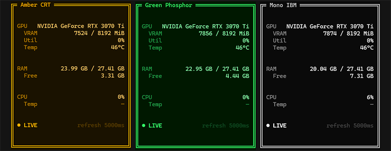

# opencode-system-stats



A local [OpenCode](https://opencode.ai) plugin that renders a real-time system
stats panel **directly in the OpenCode TUI** — VRAM, RAM, CPU load, and GPU/CPU
temperature — as a floating overlay you can drop in any corner of the screen.
Refresh rate and palette are configurable, and you can add your own themes with
plain YAML files.


## Features

- **VRAM** used / total + utilization and temperature (color-coded bands).
- **RAM** used / total / free.
- **CPU load %** and temperature — CPU temp is read cross-platform:
  LibreHardwareMonitor over HTTP on WSL2/Windows, `systeminformation` on bare
  Linux/macOS, sysfs as a last resort. Renders `—` when nothing exposes a sensor.
- **Configurable refresh rate** (`200 / 500 / 1000 / 2000 / 5000` ms), persisted.
- **Floating overlay** with six anchors (corners + top/bottom centre).
- **Three phosphor themes** (`amber`, `green`, `mono`) + [custom themes](#themes)
  via YAML.

## Install

Local plugins under `.opencode/plugins/` are auto-loaded by OpenCode v2.x — no
configuration required.

1. Clone this repo (or download and unzip it).
2. Copy the plugin into the project where you want it:
   ```bash
   cp -r opencode-system-stats/.opencode/plugins/opencode-system-stats \
     /path/to/your-project/.opencode/plugins/
   ```
   (the `.opencode/plugins/` directory is created automatically by OpenCode, but
   `mkdir -p .opencode/plugins` first if you're copying by hand)
3. **Restart OpenCode** (service + TUI) to load the plugin.
4. Open a project and type `/system-stats` to toggle the panel.

## Usage

Slash commands (also reachable from the panel footer):

- `/system-stats` — toggle the overlay open/closed
- `/system-stats-refresh` — change the refresh rate
- `/system-stats-theme` — switch palette (built-ins + your custom themes)
- `/system-stats-position` — move the overlay to a different anchor

## Themes

Beyond the three built-in phosphor palettes, add your own themes with plain YAML
files that live **outside the plugin directory** (in a separate folder) so they
survive plugin updates.

1. Pick a theme directory, e.g. `~/.config/system-stats-themes`.
2. Set the environment variable (in the shell where you launch OpenCode — the
   server half, a separate process, reads it):
   ```bash
   export SYSTEM_STATS_THEME_DIR="$HOME/.config/system-stats-themes"
   ```
3. Add one theme per `*.yaml`/`*.yml` file — see the schema below.
4. Restart OpenCode. Your theme joins the same selector as the built-ins.

**File schema** (one theme per file):

```yaml
name: sunset        # optional; id used by the selector
label: Sunset CRT   # optional; shown in the list (defaults to `name`)
palette:
  bg: "#1a0a00"     # background
  accent: "#ff7b00" # highlighted accents / active chips
  base: "#ffb36b"   # primary text
  muted: "#a85d00"  # labels
  warn: "#ffb000"   # warning values
  crit: "#ff3b2f"   # critical values
  border: "#ff7b00" # panel borders
```

Rules: `palette` must define all seven fields; every value is a hex color (`#fff`
or `#ff8800`). `name` must match `^[a-z0-9][a-z0-9._-]*$`. A bad file is skipped
with a warning and doesn't affect the others.

### Example themes

This repo ships two ready-made samples in [`examples/themes/`](examples/themes/)
(`sunset.yaml`, `c64.yaml`). Copy one into your theme directory and set
`SYSTEM_STATS_THEME_DIR` — see [`examples/themes/_README.md`](examples/themes/_README.md).
For the full tutorial (picking colors, error handling), see the plugin's
[Custom themes (YAML)](.opencode/plugins/opencode-system-stats/README.md#custom-themes-yaml)
section.

## Development

```bash
cd .opencode/plugins/opencode-system-stats
npx tsc --noEmit   # type-check (tsconfig.json is for editor/IDE support only)
```

The plugin is authored in TypeScript/TSX, but OpenCode transpiles it on the fly;
`tsconfig.json` is only for editor support.

## Requirements

- OpenCode v2.x
- `nvidia-smi` on PATH for GPU data (RAM/CPU work without it)
- On **WSL2**, CPU temperature comes from **LibreHardwareMonitor** on Windows
  (needs a Windows firewall rule for port 8085; mirrored networking or a
  portproxy under NAT). See the [plugin README](.opencode/plugins/opencode-system-stats/README.md#cpu-temperature-librehardwaremonitor)
  for details.

## License

Released under the [MIT License](LICENSE).
